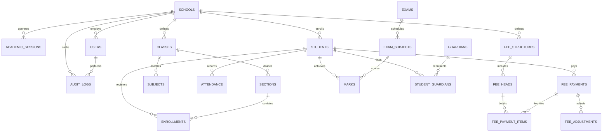

# Database Design & Schema Specification

## 1. Entity-Relationship Overview

The database uses SQLite with strict relational enforcement (`PRAGMA foreign_keys = ON`), Write-Ahead Logging (`PRAGMA journal_mode = WAL`), and tenant-scoping via `school_id`.

---

## 2. Table Schemas, Constraints & Indexes

### A. Multi-Tenant Master Tables
1. **`schools`**
   - `id`: `INTEGER PRIMARY KEY AUTOINCREMENT`
   - `code`: `TEXT NOT NULL UNIQUE` (e.g. `SCH-001`)
   - `name`: `TEXT NOT NULL`
   - `affiliation_number`: `TEXT` (e.g. CBSE affiliation number)
   - `udise_code`: `TEXT` (11-digit UDISE+ identifier)
   - `email`: `TEXT NOT NULL`
   - `phone`: `TEXT NOT NULL`
   - `address`: `TEXT NOT NULL`
   - `city`: `TEXT NOT NULL`
   - `state`: `TEXT NOT NULL`
   - `postal_code`: `TEXT NOT NULL`
   - `status`: `TEXT NOT NULL DEFAULT 'active'` (`active`, `inactive`)
   - `created_at`: `TEXT NOT NULL DEFAULT CURRENT_TIMESTAMP`

2. **`academic_sessions`**
   - `id`: `INTEGER PRIMARY KEY AUTOINCREMENT`
   - `school_id`: `INTEGER NOT NULL REFERENCES schools(id) ON DELETE CASCADE`
   - `name`: `TEXT NOT NULL` (e.g. `2026-2027`)
   - `start_date`: `TEXT NOT NULL` (ISO format `YYYY-MM-DD`)
   - `end_date`: `TEXT NOT NULL`
   - `is_current`: `INTEGER NOT NULL DEFAULT 0`
   - `created_at`: `TEXT NOT NULL DEFAULT CURRENT_TIMESTAMP`
   - Index: `UNIQUE(school_id, name)`

### B. Identity, RBAC & Audit
3. **`users`**
   - `id`: `INTEGER PRIMARY KEY AUTOINCREMENT`
   - `school_id`: `INTEGER REFERENCES schools(id) ON DELETE CASCADE` (NULL for platform `superadmin`)
   - `username`: `TEXT NOT NULL UNIQUE`
   - `email`: `TEXT NOT NULL UNIQUE`
   - `password_hash`: `TEXT NOT NULL`
   - `password_salt`: `TEXT NOT NULL`
   - `full_name`: `TEXT NOT NULL`
   - `role`: `TEXT NOT NULL` (`superadmin`, `admin`, `principal`, `teacher`, `accountant`, `admission_staff`, `student`, `parent`)
   - `phone`: `TEXT`
   - `status`: `TEXT NOT NULL DEFAULT 'active'` (`active`, `suspended`, `inactive`)
   - `last_login_at`: `TEXT`
   - `created_at`: `TEXT NOT NULL DEFAULT CURRENT_TIMESTAMP`

4. **`audit_logs`**
   - `id`: `INTEGER PRIMARY KEY AUTOINCREMENT`
   - `school_id`: `INTEGER REFERENCES schools(id) ON DELETE CASCADE`
   - `user_id`: `INTEGER REFERENCES users(id) ON DELETE SET NULL`
   - `action`: `TEXT NOT NULL` (e.g. `FEE_PAYMENT_COLLECTED`, `MARKS_PUBLISHED`, `USER_LOGIN`)
   - `resource_type`: `TEXT NOT NULL` (e.g. `fees`, `admissions`, `exams`)
   - `resource_id`: `TEXT`
   - `old_values`: `TEXT` (JSON string)
   - `new_values`: `TEXT` (JSON string)
   - `ip_address`: `TEXT`
   - `user_agent`: `TEXT`
   - `created_at`: `TEXT NOT NULL DEFAULT CURRENT_TIMESTAMP`
   - Index: `(school_id, created_at)`, `(user_id, created_at)`

### C. Academic Structure
5. **`classes`**
   - `id`: `INTEGER PRIMARY KEY AUTOINCREMENT`
   - `school_id`: `INTEGER NOT NULL REFERENCES schools(id) ON DELETE CASCADE`
   - `name`: `TEXT NOT NULL` (e.g. `Grade 10`, `Nursery`)
   - `code`: `TEXT NOT NULL` (e.g. `G10`)
   - `numeric_level`: `INTEGER NOT NULL` (e.g. 10)
   - Index: `UNIQUE(school_id, code)`

6. **`sections`**
   - `id`: `INTEGER PRIMARY KEY AUTOINCREMENT`
   - `school_id`: `INTEGER NOT NULL REFERENCES schools(id) ON DELETE CASCADE`
   - `class_id`: `INTEGER NOT NULL REFERENCES classes(id) ON DELETE CASCADE`
   - `name`: `TEXT NOT NULL` (e.g. `A`, `B`, `Rose`)
   - `capacity`: `INTEGER NOT NULL DEFAULT 40`
   - `class_teacher_id`: `INTEGER REFERENCES users(id) ON DELETE SET NULL`
   - Index: `UNIQUE(school_id, class_id, name)`

7. **`subjects`**
   - `id`: `INTEGER PRIMARY KEY AUTOINCREMENT`
   - `school_id`: `INTEGER NOT NULL REFERENCES schools(id) ON DELETE CASCADE`
   - `class_id`: `INTEGER NOT NULL REFERENCES classes(id) ON DELETE CASCADE`
   - `name`: `TEXT NOT NULL` (e.g. `Mathematics`, `Science`, `Hindi`)
   - `code`: `TEXT NOT NULL` (e.g. `MATH-10`)
   - `type`: `TEXT NOT NULL DEFAULT 'theory'` (`theory`, `practical`, `both`)
   - `max_marks`: `REAL NOT NULL DEFAULT 100.0`
   - Index: `UNIQUE(school_id, class_id, code)`

### D. Admissions & Student Information (SIS)
8. **`admissions`**
   - `id`: `INTEGER PRIMARY KEY AUTOINCREMENT`
   - `school_id`: `INTEGER NOT NULL REFERENCES schools(id) ON DELETE CASCADE`
   - `session_id`: `INTEGER NOT NULL REFERENCES academic_sessions(id) ON DELETE CASCADE`
   - `application_no`: `TEXT NOT NULL` (e.g. `APP-2026-0001`)
   - `first_name`: `TEXT NOT NULL`
   - `last_name`: `TEXT NOT NULL`
   - `date_of_birth`: `TEXT NOT NULL`
   - `gender`: `TEXT NOT NULL` (`male`, `female`, `other`)
   - `applying_for_class_id`: `INTEGER NOT NULL REFERENCES classes(id)`
   - `guardian_name`: `TEXT NOT NULL`
   - `guardian_phone`: `TEXT NOT NULL`
   - `guardian_email`: `TEXT`
   - `address`: `TEXT NOT NULL`
   - `category_caste`: `TEXT DEFAULT 'General'`
   - `rte_candidate`: `INTEGER NOT NULL DEFAULT 0` (1 for RTE 25% quota)
   - `status`: `TEXT NOT NULL DEFAULT 'submitted'` (`submitted`, `under_review`, `approved`, `rejected`, `enrolled`)
   - `rejection_reason`: `TEXT`
   - `reviewed_by`: `INTEGER REFERENCES users(id)`
   - `created_at`: `TEXT NOT NULL DEFAULT CURRENT_TIMESTAMP`
   - Index: `UNIQUE(school_id, application_no)`

9. **`students`**
   - `id`: `INTEGER PRIMARY KEY AUTOINCREMENT`
   - `school_id`: `INTEGER NOT NULL REFERENCES schools(id) ON DELETE CASCADE`
   - `admission_id`: `INTEGER REFERENCES admissions(id)`
   - `admission_number`: `TEXT NOT NULL` (e.g. `SCH-ADM-2026-0042`)
   - `roll_number`: `TEXT`
   - `first_name`: `TEXT NOT NULL`
   - `last_name`: `TEXT NOT NULL`
   - `date_of_birth`: `TEXT NOT NULL`
   - `gender`: `TEXT NOT NULL`
   - `blood_group`: `TEXT`
   - `aadhaar_enrolled`: `INTEGER DEFAULT 0`
   - `category_caste`: `TEXT DEFAULT 'General'`
   - `rte_student`: `INTEGER NOT NULL DEFAULT 0`
   - `primary_phone`: `TEXT NOT NULL`
   - `primary_email`: `TEXT`
   - `residential_address`: `TEXT NOT NULL`
   - `emergency_contact_name`: `TEXT NOT NULL`
   - `emergency_contact_phone`: `TEXT NOT NULL`
   - `status`: `TEXT NOT NULL DEFAULT 'active'` (`active`, `transferred`, `withdrawn`, `graduated`)
   - `created_at`: `TEXT NOT NULL DEFAULT CURRENT_TIMESTAMP`
   - Index: `UNIQUE(school_id, admission_number)`

10. **`enrollments`**
    - `id`: `INTEGER PRIMARY KEY AUTOINCREMENT`
    - `school_id`: `INTEGER NOT NULL REFERENCES schools(id) ON DELETE CASCADE`
    - `student_id`: `INTEGER NOT NULL REFERENCES students(id) ON DELETE CASCADE`
    - `session_id`: `INTEGER NOT NULL REFERENCES academic_sessions(id) ON DELETE CASCADE`
    - `class_id`: `INTEGER NOT NULL REFERENCES classes(id) ON DELETE CASCADE`
    - `section_id`: `INTEGER NOT NULL REFERENCES sections(id) ON DELETE CASCADE`
    - `roll_no`: `INTEGER`
    - `enrolled_date`: `TEXT NOT NULL`
    - `status`: `TEXT NOT NULL DEFAULT 'active'` (`active`, `promoted`, `completed`)
    - Index: `UNIQUE(school_id, student_id, session_id)`

11. **`guardians`** & **`student_guardians`**
    - `guardians`: `id`, `school_id`, `name`, `relationship`, `phone`, `email`, `occupation`, `address`
    - `student_guardians`: `student_id`, `guardian_id`, `is_primary`

### E. Attendance
12. **`attendance`**
    - `id`: `INTEGER PRIMARY KEY AUTOINCREMENT`
    - `school_id`: `INTEGER NOT NULL REFERENCES schools(id) ON DELETE CASCADE`
    - `session_id`: `INTEGER NOT NULL REFERENCES academic_sessions(id) ON DELETE CASCADE`
    - `class_id`: `INTEGER NOT NULL REFERENCES classes(id) ON DELETE CASCADE`
    - `section_id`: `INTEGER NOT NULL REFERENCES sections(id) ON DELETE CASCADE`
    - `student_id`: `INTEGER NOT NULL REFERENCES students(id) ON DELETE CASCADE`
    - `attendance_date`: `TEXT NOT NULL` (ISO format `YYYY-MM-DD`)
    - `status`: `TEXT NOT NULL` (`present`, `absent`, `late`, `excused`)
    - `remarks`: `TEXT`
    - `recorded_by`: `INTEGER NOT NULL REFERENCES users(id)`
    - `created_at`: `TEXT NOT NULL DEFAULT CURRENT_TIMESTAMP`
    - Index: `UNIQUE(school_id, student_id, attendance_date)`

### F. Fees & Financial Accounting
13. **`fee_heads`**
    - `id`: `INTEGER PRIMARY KEY AUTOINCREMENT`
    - `school_id`: `INTEGER NOT NULL REFERENCES schools(id) ON DELETE CASCADE`
    - `name`: `TEXT NOT NULL` (e.g. `Tuition Fee`, `Annual Development`, `Transport Fee`, `Lab Fee`)
    - `code`: `TEXT NOT NULL`
    - `description`: `TEXT`
    - Index: `UNIQUE(school_id, code)`

14. **`fee_structures`**
    - `id`: `INTEGER PRIMARY KEY AUTOINCREMENT`
    - `school_id`: `INTEGER NOT NULL REFERENCES schools(id) ON DELETE CASCADE`
    - `session_id`: `INTEGER NOT NULL REFERENCES academic_sessions(id) ON DELETE CASCADE`
    - `class_id`: `INTEGER NOT NULL REFERENCES classes(id) ON DELETE CASCADE`
    - `name`: `TEXT NOT NULL`
    - `frequency`: `TEXT NOT NULL DEFAULT 'quarterly'` (`monthly`, `quarterly`, `annual`)
    - `total_amount`: `REAL NOT NULL`
    - Index: `UNIQUE(school_id, session_id, class_id, name)`

15. **`fee_structure_items`**
    - `id`: `INTEGER PRIMARY KEY AUTOINCREMENT`
    - `structure_id`: `INTEGER NOT NULL REFERENCES fee_structures(id) ON DELETE CASCADE`
    - `fee_head_id`: `INTEGER NOT NULL REFERENCES fee_heads(id) ON DELETE CASCADE`
    - `amount`: `REAL NOT NULL`

16. **`student_fee_allocations`**
    - `id`: `INTEGER PRIMARY KEY AUTOINCREMENT`
    - `school_id`: `INTEGER NOT NULL REFERENCES schools(id) ON DELETE CASCADE`
    - `student_id`: `INTEGER NOT NULL REFERENCES students(id) ON DELETE CASCADE`
    - `session_id`: `INTEGER NOT NULL REFERENCES academic_sessions(id) ON DELETE CASCADE`
    - `structure_id`: `INTEGER NOT NULL REFERENCES fee_structures(id) ON DELETE CASCADE`
    - `gross_amount`: `REAL NOT NULL`
    - `discount_amount`: `REAL NOT NULL DEFAULT 0.0`
    - `net_payable`: `REAL NOT NULL`
    - `due_date`: `TEXT NOT NULL`
    - `status`: `TEXT NOT NULL DEFAULT 'unpaid'` (`unpaid`, `partial`, `paid`)

17. **`fee_payments`** (Immutable collections)
    - `id`: `INTEGER PRIMARY KEY AUTOINCREMENT`
    - `school_id`: `INTEGER NOT NULL REFERENCES schools(id) ON DELETE CASCADE`
    - `allocation_id`: `INTEGER NOT NULL REFERENCES student_fee_allocations(id) ON DELETE CASCADE`
    - `receipt_number`: `TEXT NOT NULL` (e.g. `REC-2026-0001`)
    - `idempotency_key`: `TEXT UNIQUE`
    - `payment_date`: `TEXT NOT NULL`
    - `amount_paid`: `REAL NOT NULL`
    - `payment_mode`: `TEXT NOT NULL` (`cash`, `upi`, `cheque`, `online_mock`, `bank_transfer`)
    - `transaction_reference`: `TEXT`
    - `collected_by`: `INTEGER NOT NULL REFERENCES users(id)`
    - `notes`: `TEXT`
    - `is_reversed`: `INTEGER NOT NULL DEFAULT 0`
    - `created_at`: `TEXT NOT NULL DEFAULT CURRENT_TIMESTAMP`
    - Index: `UNIQUE(school_id, receipt_number)`

18. **`fee_adjustments`** (Controlled Reversals)
    - `id`: `INTEGER PRIMARY KEY AUTOINCREMENT`
    - `school_id`: `INTEGER NOT NULL REFERENCES schools(id) ON DELETE CASCADE`
    - `payment_id`: `INTEGER NOT NULL REFERENCES fee_payments(id) ON DELETE CASCADE`
    - `reversal_receipt_no`: `TEXT NOT NULL UNIQUE`
    - `amount`: `REAL NOT NULL`
    - `reason`: `TEXT NOT NULL`
    - `authorized_by`: `INTEGER NOT NULL REFERENCES users(id)`
    - `created_at`: `TEXT NOT NULL DEFAULT CURRENT_TIMESTAMP`

### G. Examinations & Report Cards
19. **`exams`**
    - `id`: `INTEGER PRIMARY KEY AUTOINCREMENT`
    - `school_id`: `INTEGER NOT NULL REFERENCES schools(id) ON DELETE CASCADE`
    - `session_id`: `INTEGER NOT NULL REFERENCES academic_sessions(id) ON DELETE CASCADE`
    - `name`: `TEXT NOT NULL` (e.g. `Term 1 Mid-Term Assessment`, `Annual Final Exam`)
    - `start_date`: `TEXT NOT NULL`
    - `end_date`: `TEXT NOT NULL`
    - `status`: `TEXT NOT NULL DEFAULT 'draft'` (`draft`, `scheduled`, `ongoing`, `completed`, `published`)
    - `published_at`: `TEXT`
    - `published_by`: `INTEGER REFERENCES users(id)`
    - Index: `UNIQUE(school_id, session_id, name)`

20. **`exam_subjects`**
    - `id`: `INTEGER PRIMARY KEY AUTOINCREMENT`
    - `exam_id`: `INTEGER NOT NULL REFERENCES exams(id) ON DELETE CASCADE`
    - `class_id`: `INTEGER NOT NULL REFERENCES classes(id) ON DELETE CASCADE`
    - `subject_id`: `INTEGER NOT NULL REFERENCES subjects(id) ON DELETE CASCADE`
    - `exam_date`: `TEXT NOT NULL`
    - `max_marks`: `REAL NOT NULL DEFAULT 100.0`
    - `passing_marks`: `REAL NOT NULL DEFAULT 33.0`
    - Index: `UNIQUE(exam_id, class_id, subject_id)`

21. **`marks`**
    - `id`: `INTEGER PRIMARY KEY AUTOINCREMENT`
    - `school_id`: `INTEGER NOT NULL REFERENCES schools(id) ON DELETE CASCADE`
    - `exam_subject_id`: `INTEGER NOT NULL REFERENCES exam_subjects(id) ON DELETE CASCADE`
    - `student_id`: `INTEGER NOT NULL REFERENCES students(id) ON DELETE CASCADE`
    - `marks_obtained`: `REAL`
    - `is_absent`: `INTEGER NOT NULL DEFAULT 0`
    - `grade`: `TEXT` (e.g. `A1`, `A2`, `B1`, `F`)
    - `remarks`: `TEXT`
    - `entered_by`: `INTEGER NOT NULL REFERENCES users(id)`
    - `updated_at`: `TEXT NOT NULL DEFAULT CURRENT_TIMESTAMP`
    - Index: `UNIQUE(exam_subject_id, student_id)`

### H. Auxiliary Modules
22. **`staff`**: `id`, `school_id`, `user_id`, `employee_code`, `department`, `designation`, `joining_date`, `qualification`, `salary_amount`
23. **`timetable_slots`**: `id`, `school_id`, `class_id`, `section_id`, `subject_id`, `teacher_id`, `day_of_week` (1-6), `period_number`, `start_time`, `end_time`. (Conflict check on `(school_id, teacher_id, day_of_week, period_number)`)
24. **`homework`** & **`homework_submissions`**: Homework tasks, due dates, class targeting, and submissions.
25. **`books`** & **`book_issues`**: ISBN, title, author, category, total copies, available copies, borrower ID, issue date, due date, return date, fine.
26. **`transport_routes`**, **`transport_stops`**, **`student_transport`**: Vehicle number, route name, driver name & contact, pickup stop, seat allocation.
27. **`notices`**: Title, content, target audience (`all`, `teachers`, `students`, `parents`), publish date, expiry date.

---

## 3. Data Integrity & Retention Rules

1. **Foreign Key Enforcement**: All relational tables strictly configure `ON DELETE CASCADE` or `ON DELETE SET NULL` as specified.
2. **Transaction Isolation**: Any operation impacting multiple tables (e.g., admitting an applicant, collecting fees, batch recording attendance) is executed inside an atomic transaction block.
3. **No Financial Deletion**: Ledger records in `fee_payments` can only be adjusted via `fee_adjustments`.
4. **Tenant Scoping Guarantee**: Every query initiated on behalf of a tenant must incorporate `WHERE school_id = ?` into the query predicates.
