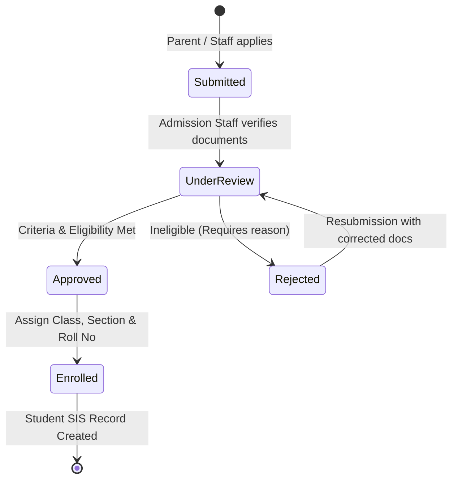
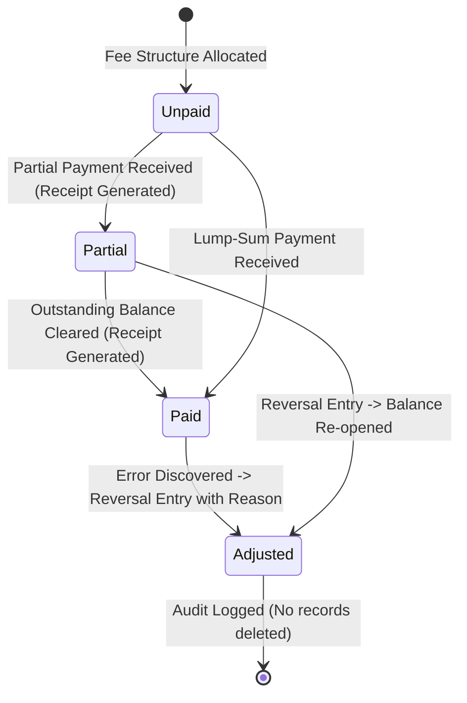
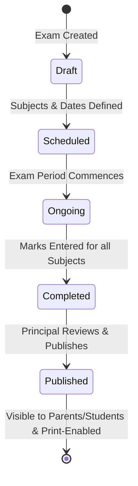

# UI Screen Flows & Navigation Architecture

## 1. Global Navigation Hierarchy

The application interface utilizes a responsive layout with a collapsible sidebar, contextual breadcrumbs, quick search, tenant switcher (for Superadmin), and user profile drawer:

```
[ Top Header: School Name / Tenant | Global Search | Notifications | User Profile & Logout ]
+-------------------+-----------------------------------------------------------------------+
|  Sidebar          |  Main Content Workspace                                               |
|  - Dashboard      |  - Role-specific metrics cards & quick actions                        |
|  - Academic       |  - Filterable data tables with search, sort & pagination              |
|  - Admissions     |  - Action toolbars (New Record, Export CSV, Print)                    |
|  - Students       |  - Form drawers & confirmation modals                                 |
|  - Attendance     |  - Empty states with call-to-actions                                  |
|  - Fees & Billing |  - Dedicated printable viewports for Receipts & Report Cards          |
|  - Examinations   |                                                                       |
|  - HR & Staff     |                                                                       |
|  - Timetable      |                                                                       |
|  - Library        |                                                                       |
|  - Transport      |                                                                       |
|  - Reports        |                                                                       |
|  - Settings/Audit |                                                                       |
+-------------------+-----------------------------------------------------------------------+
```

---

## 2. State-Transition Workflows

### A. Admissions Lifecycle State Machine



- **Transitions**:
  - `Submitted` -> `UnderReview`: Authorized: `admission_staff`, `admin`.
  - `UnderReview` -> `Approved`: Authorized: `admission_staff`, `principal`.
  - `UnderReview` -> `Rejected`: Requires mandatory `rejection_reason`.
  - `Approved` -> `Enrolled`: Generates unique student ID, allocates class & section, creates fee allocation.

---

### B. Fee Collection & Adjustment Flow



- **Invariants**:
  - Payment cannot exceed outstanding balance.
  - Submitting payment generates a unique receipt sequence (`REC-YYYY-XXXX`).
  - Idempotency key prevents double charge on quick double-clicks.
  - Reversal requires reason and creates a compensating entry.

---

### C. Examination & Report Card Publishing Flow



- **Rules**:
  - Teachers can enter marks while `Scheduled` or `Ongoing` or `Completed`.
  - Marks exceeding `max_marks` are blocked client-side and server-side.
  - Once `Published`, marks are locked. Only `admin` with audit justification can perform post-publication corrections.

---

## 3. Role-Specific Dashboards

1. **School Admin / Principal**:
   - Total Students, Active Staff, Today's Attendance %, Month-to-date Fee Collections.
   - Pending admission applications requiring review.
   - Recent system audit events.
2. **Teacher**:
   - Assigned class & section shortcuts.
   - One-click daily attendance marking.
   - Timetable slots for the day.
   - Pending marks entry alerts.
3. **Accountant / Fee Manager**:
   - Daily collection total, cash vs. UPI vs. bank transfer breakdown.
   - Overdue / defaulter student list with filter by class.
   - Instant receipt lookup and print tool.
4. **Student / Parent**:
   - Student academic overview, attendance percentage gauge.
   - Upcoming exams and published report cards.
   - Fee invoices, payment receipts, and outstanding dues.
   - Notice board and announcements.
